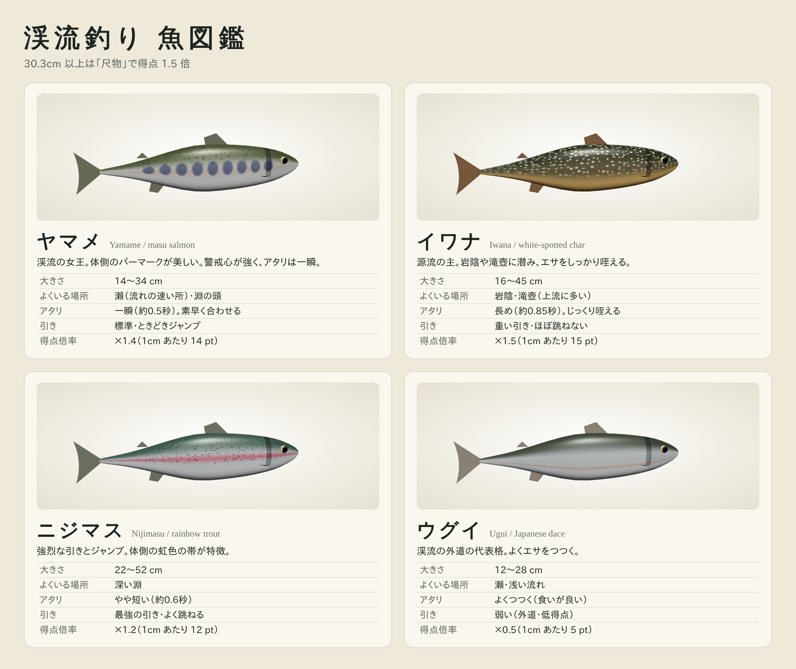

# 渓流釣り（Trout Stream Fishing 3D）

山あいの清流でヤマメ・イワナを「目印釣り」で、アユを「友釣り」で狙う、ブラウザで遊べる 3D 渓流釣りゲームです。
日本語 / English に対応しています（右上のボタンで切り替え）。
ビルド不要の静的サイト（Three.js / ES Modules）で、モデル・テクスチャ・効果音はすべてプログラムで生成しています。

## 遊び方

1. **振り込み** — 水面にカーソルを合わせ（緑の輪）クリック／タップ
2. **流し** — 仕掛けは流れに乗って下ります。岩の裏や淵に魚が潜んでいます
3. **合わせ** — 目印がピクッと動いたら（アタリ！）すかさずクリック／スペース
4. **やり取り** — 長押しで竿を立てて寄せ、離して引きをいなす。テンションが強すぎると糸切れ、緩すぎるとバラシ
5. **取り込み** — 魚の体力を削って手前に寄せるとタモ入れ

### 友釣り（アユ）

タイトル画面で「友釣り」を選ぶと遊べます（新緑・盛夏のみ）。

1. 瀬（浅く流れの速い所）をクリックして、おとりのアユを送り出す
2. 水面をクリックすると、おとりがそこへ泳ぐ。アユの縄張りに入ると、野アユが体当たりして掛け針に掛かる（合わせ不要）
3. おとりは泳ぐほど弱る（左上の「おとりの元気」）。スペースで回収して休ませるか、釣れたアユを「おとりにする」で交代

| 操作 | キー |
| --- | --- |
| 上流 / 下流へ移動 | A・← / D・→ |
| 視点回転 | 右ドラッグ / Q・E（スマホは2本指） |
| ズーム | ホイール / ピンチ |
| 合わせ・寄せ | スペース / クリック |

時間帯（朝マズメ・日中・夕マズメ）と季節（新緑・盛夏・紅葉）を選べます。マズメ時は魚の活性が上がります。

## 魚種



ヤマメ・イワナ・ニジマス・アユ・ウグイ。30.3cm 以上は「尺物」としてボーナス。
釣った魚はゲーム内の「図鑑」に登録されます（未登録の魚はシルエット表示）。自己記録・図鑑はブラウザに保存されます。

## 再現しているもの

- 蛇行する渓流・瀬と淵・滝と滝壺・河原（プロシージャル地形）
- 流れる水面シェーダー（流速に応じた波・白泡・岩まわりの泡・水深による色・フレネル反射）、川底のコースティクス
- スギ林と広葉樹（風で揺れる）、水面を流れる落ち葉、滝の飛沫
- 釣り人（IKで竿を握る腕、歩行アニメ、タモ）、曲がる竿、目印付きの仕掛け
- 魚の行動（定位・エサへの接近・人影や着水音で逃げる）、ライズ
- 川のせせらぎ・滝の音・野鳥、琴と尺八風の和風BGM（Web Audio で合成。ファイト中は太鼓入りの速い曲に）
- スマホの振動（アタリ・掛かり・魚の引き・ジャンプ・糸切れ警告。iPhone の Safari は非対応）

## Android アプリ

[Capacitor](https://capacitorjs.com/) でゲームのファイルをアプリに同梱しています（オフラインで遊べます）。パッケージ名は `jp.techgym.river`。

- 動作確認用 APK（テスト広告・デバッグ署名）のリリース画面：https://github.com/techgymjp/river/releases/tag/android-latest
- APK を直接ダウンロード：https://github.com/techgymjp/river/releases/latest/download/keiryu.apk
- スマホで読み取る QR コード（リリース画面）：

  

`main` に push すると GitHub Actions（`.github/workflows/android.yml`）が APK をビルドして上のリリースに載せます。
GitHub Secrets（`ANDROID_KEYSTORE_BASE64` など 4 つ）を登録すると、Google Play 用の署名付き AAB（本番広告）も Artifact に作られます。

広告（AdMob）はアプリのときだけ出ます（Web 版では出ません）。

| 種類 | 出す場面 |
| --- | --- |
| バナー | トップ・釣りの準備・あそびかた・一時停止・本日の釣果の画面だけ（プレイ中は出さない） |
| 全画面広告 | 「釣りを始める」「一時停止からの再開」「トップに戻る」「もう一度」のたび |
| リワード広告 | 糸切れ・バラシで逃がした魚を、広告を見て「掛け直す」（1 回の釣行で 5 回まで。本日の釣果とシェア文に回数を表示） |

```bash
npm ci
```

```bash
npm run android:sync
```

```bash
npm run android:open
```

## ローカルで動かす

ES Modules を使うため、ローカルサーバー経由で開いてください。

```bash
python3 -m http.server 8000
```

ブラウザで http://localhost:8000 を開きます。Three.js は `js/vendor/three/` に同梱しています。

## 公開

`main` ブランチのルートを GitHub Pages で公開しています（push すると自動で再デプロイ）。

https://techgymjp.github.io/river/

## ライセンス

著作権はテックジム株式会社に帰属します（All rights reserved）。許可なく複製・改変・再配布すること、Web サイトやアプリ（Google Play・App Store など）として公開・販売すること、名前・アイコン・画像を使うことを禁止します。
テックジムの受講生が学習目的で複製・改変することは許可します（アプリストアでの公開・広告の掲載・販売などの商用利用は不可、著作権表示は残す）。
同梱している Three.js は MIT License です。詳しくは [LICENSE](LICENSE) を見てください。
